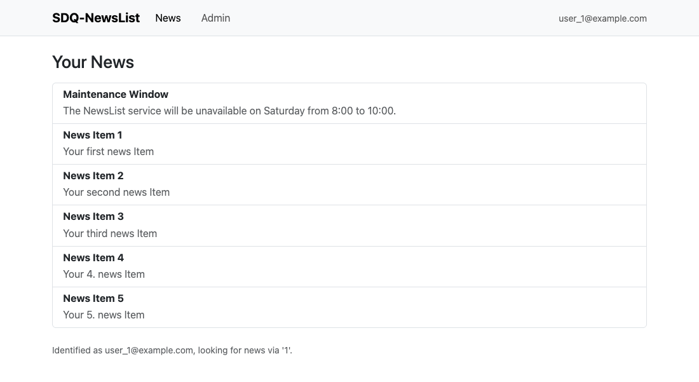
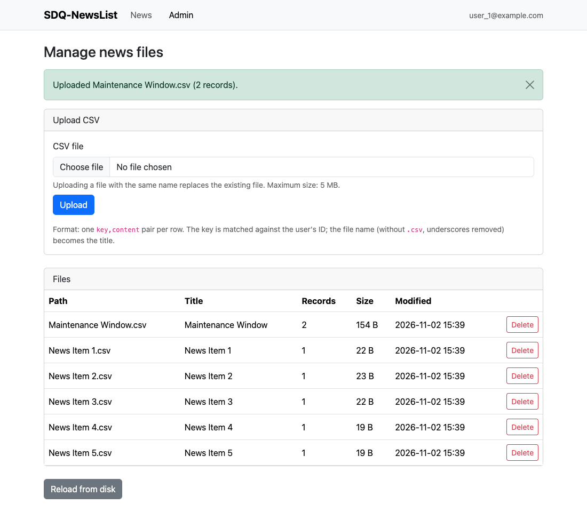

# NewsList

Shows user-specific "news items" after SAML2 login. News items are loaded from CSV files on disk and matched against a SAML2 user attribute.

## Screenshots

| Your news | Admin interface |
|---|---|
|  |  |

| Dark mode | Mobile |
|---|---|
|  |  |

## Demo (Docker Compose)

The `demo/` folder contains a ready-to-run setup including a test SAML IdP.

```bash
cd demo
docker compose up
```

- Open http://localhost:8080
- Log in with `user1` / `user1pass` (admin, see `/admin`) or `user2` / `user2pass` (regular user)

The demo mounts `demo/news` writable so the admin interface can change it. On Linux hosts, make it writable for the container user first (see [Writable storage](#writable-storage)): `sudo chown -R 999 demo/news`.

## Configuration

Configuration is done via `application.yml`.

Spring Boot also reads external config from `./application.yml` and `./config/application.yml` relative to the working directory. In the Docker demo, the config is mounted to `/usr/src/newslist/config/application.yml`.

## News CSVs

### Configuration keys

- `news.csv-path`: Directory that contains the `.csv` files (the directory is scanned recursively).
- `news.csv-format`: Apache Commons CSV predefined format name (see `CSVFormat.Predefined`), e.g. `Default`.
- `news.saml2-key`: The SAML2 attribute name whose value is used as the lookup key (demo: `uid`).

### File layout

- Put one or more `.csv` files into the directory configured via `news.csv-path`.
- All `.csv` files found under that path are loaded at startup and after each change through the admin interface (sorted by file path/name).

The filename (without `.csv`) becomes the **title** of the news item. Underscores are removed.

Example filenames:

- `News Item 1.csv` → title: `News Item 1`
- `Security_Notice.csv` → title: `SecurityNotice`

### CSV rows (format)

Each CSV record must have **exactly two columns**:

1. **Key**: must match the logged-in user’s SAML2 attribute value (as configured by `news.saml2-key`).
2. **Content**: the text to display for that news item.

Records with anything other than exactly two columns are skipped.

Examples (using `news.csv-format: Default`):

```csv
user1,Welcome to NewsList!
user2,"This message contains a comma, so it is quoted."
```

### Applying changes

Changes made through the admin interface (see below) apply immediately. If you edit the files on disk by other means, use "Reload from disk" in the admin interface, or restart the application (e.g., `docker compose restart newslist`).

## Admin interface

Admins can upload and delete the news CSV files at `/admin`.

- `news.admin.ids`: List of user IDs allowed to use the admin interface. Each value is compared against the SAML2 attribute configured via `news.saml2-key` (demo: `uid`, so `user1` with `uid` `1` is admin). An empty list (the default) disables the admin interface. Everybody else gets HTTP 403.
- Uploads must be `.csv` files that parse with the configured `news.csv-format`; they are stored in the root of `news.csv-path` and replace a file with the same name. Rows without exactly two columns are skipped with a warning.
- `news.admin.max-upload-size`: Maximum size of an uploaded CSV (default `5MB`). It must stay below `spring.servlet.multipart.max-file-size`/`max-request-size` (default config: `8MB`), which act as a hard cap answered with a bare HTTP 413.
- `news.csv-path` must be **writable** by the application, see [Writable storage](#writable-storage).

## Writable storage

The only location NewsList writes to is the `news.csv-path` directory:

- Uploads are written there (via a temporary `.upload-*.tmp` file in the same directory that is then moved into place), and deletes remove files from it.
- If the directory does not exist, it is created on the first upload, so its parent must be writable in that case.
- Everything else, in particular `application.yml`, can stay read-only.

If the directory is not writable, NewsList still serves news, but uploads and deletes fail with an error message in the admin interface.

### Docker

The image runs as **UID 999**. A host directory mounted as `news.csv-path` must therefore be writable by that UID, and must not be mounted with `:ro`:

```bash
mkdir -p news
sudo chown -R 999 news   # or: sudo chmod -R a+rwX news
```

With Docker Desktop (macOS/Windows), bind mounts are usually writable without changing ownership.

Mount the config read-only and the news directory writable as separate volumes (don't mount the news directory inside a read-only mount):

```yaml
volumes:
  - ./config/application.yml:/usr/src/newslist/config/application.yml:ro
  - ./news/:/usr/src/newslist/news/
```

and set `news.csv-path: /usr/src/newslist/news` in `application.yml`.

## Build

The project is built with a local [Gradle](https://gradle.org/install/) installation (no Gradle wrapper) and JDK 25:

```bash
gradle bootJar    # builds build/libs/NewsList-<version>.jar
gradle test       # runs the tests; the integration tests need a running Docker daemon (Testcontainers)
```

## Docker

### Sample docker-compose.yml

```yaml
services:
  newslist:
    image: ghcr.io/kit-sdq/newslist:latest
    container_name: "newslist"
    restart: unless-stopped
    volumes:
      - ./config/application.yml:/usr/src/newslist/config/application.yml:ro
      - ./news/:/usr/src/newslist/news/   # writable by UID 999, see "Writable storage"
```

with `news.csv-path: /usr/src/newslist/news` in `config/application.yml`.

### Build locally

```bash
docker build -t newslist:local .
```

### Run locally

NewsList runs from `/usr/src/newslist/news.jar` and will pick up external config from `/usr/src/newslist/config/application.yml`. The news directory must be writable by UID 999 (see [Writable storage](#writable-storage)).

```bash
docker run -p 8080:8080 \
	-v $(pwd)/demo/application.yml:/usr/src/newslist/config/application.yml:ro \
	-v $(pwd)/demo/news:/usr/src/newslist/config/news \
	newslist:local
```

## Published Docker images

This repository publishes images to GitHub Container Registry (GHCR):

- `ghcr.io/kit-sdq/newslist:latest` is built from the `main` branch.
- Git tags like `v1.2.3` are published as `ghcr.io/kit-sdq/newslist:1.2.3`.